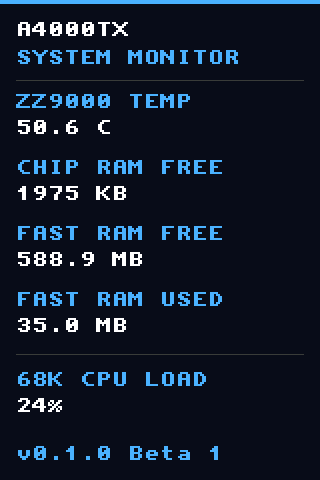
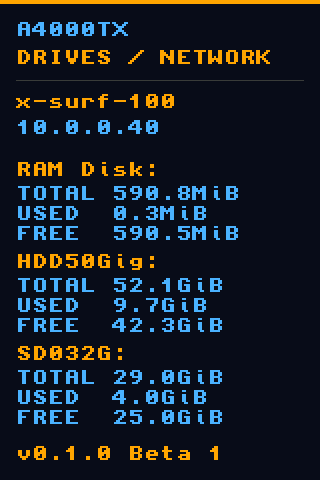
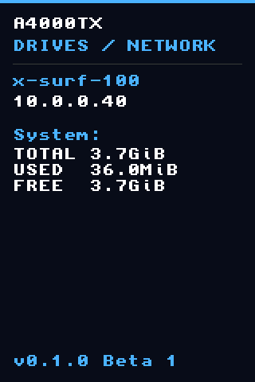
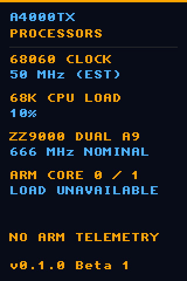
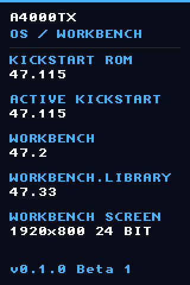
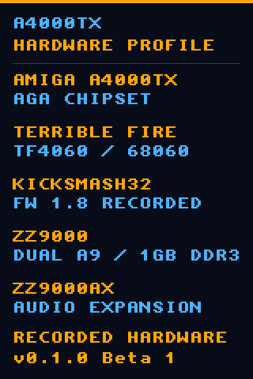
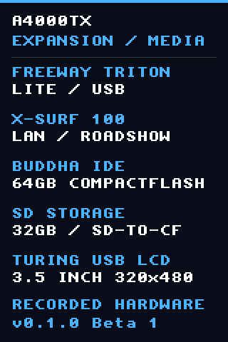
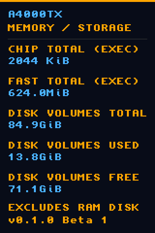

# TuringStats for Amiga


**0.1.0 Beta 1** — a native Amiga dashboard for a Turing 3.5-inch USB LCD.
Connect the display to Poseidon USB and monitor the Amiga without a PC or Mac
running alongside it.

[Download the beta](https://github.com/SkiltonUSA/TuringStats-Amiga/releases/tag/v0.1.0-beta.1)
· [Changelog](CHANGELOG.md) · [Technical notes](amiga/turing/README.md)
· [Validation](docs/validation.md)

## Features

- ZZ9000 temperature, Chip/Fast memory and sampled 68K CPU load.
- Mounted drives with total, used and free space; active IPv4 address.
- CPU clock estimate and separately labelled nominal ZZ9000 ARM clock.
- Kickstart/Workbench versions and Workbench screen resolution/depth.
- Recorded hardware profile and aggregate memory/storage totals.
- Ten-second rotating pages, alternating orange/blue and blue/white text.
- Workbench icon, Start/Stop controls and optional automatic startup.
- Missing display at boot is skipped quietly. Reconnect and relaunch the icon.
- One-instance protection and native framebuffer captures.

## Display hardware

[3.5-inch USB IPS hardware-monitor display — Temu listing](https://www.temu.com/3-5-inch-secondary-display-ips--angle-monitor-usb-surveillance-screen-usb-powered-pc-hardware--screen-desktop-pc--monitor-64-pre--for-computer-monitoring-aiad64-no-installation-required-g-606178545393396.html)

**Reference price: US$14**, as reported by the owner. Retail pricing may vary.

| Specification | Details |
| --- | --- |
| Panel | 3.5-inch IPS, as described in the linked listing |
| Resolution | 320 × 480 pixels; portrait layout used by TuringStats |
| Connection | USB data and USB power |
| Image format | 16-bit RGB565, little-endian, in the verified Rev-A protocol |
| Tested USB identity | VID:PID `1a86:5722`; device-reported serial `USB35INCHIPSV2` |
| Amiga connection | Freeway Triton Lite with Poseidon USB 4.5; native TuringStats application |

Resolution, protocol and USB identity above describe the tested unit. Match the
supported revision when choosing a display; similar-looking models can differ.

## Requirements

| Requirement | Details |
| --- | --- |
| AmigaOS | Tested on 3.2.3; installer requires icon.library 44 or newer |
| CPU | 68020 or newer; tested on a TF4060/68060. A TF4060 is not intrinsically required |
| USB | Poseidon 4 or newer and a supported USB controller; tested with Freeway Triton Lite |
| Display | Verified Rev-A Turing 3.5-inch, VID:PID `1a86:5722`, device-reported serial `USB35INCHIPSV2` |
| Memory | Approximately 300 KiB framebuffer plus application/runtime allocations; 64 KiB stack |
| ZZ9000 | Required for its temperature reading; no ARM worker or firmware change |
| Networking | A compatible bsdsocket.library stack for IPv4 information; tested with Roadshow |
| Optional | identify.library for CPU-clock estimate and physical ROM version; xSysInfo's private copy is supported |

No MUI, SDL, AHI or Mac-side agent is required. Drivers, firmware and
identify.library are not bundled. Other Turing display revisions may use
different protocols and are not supported by this beta.

The hardware-specification pages currently describe the development A4000TX
configuration. They are explicitly marked **recorded hardware**, not a fresh
automatic hardware inventory. Live readings are queried separately.

## Installation

1. Extract either release archive to a writable Amiga drawer.
2. Open the extracted drawer and double-click **Install**.
3. Launch **TuringStats** from the System drive.
4. Optionally run **Enable-Autostart** from the package drawer.

For Shell installation, change into the extracted drawer and run `Execute Install`.
The installer checks icon.library and Poseidon, retains an existing monitor as
`TuringStats.previous`, and preserves existing icon settings. It does not edit
Startup-Sequence or User-Startup. Runtime files live in `SYS:Utilities/TuringStats`.
The **Stop** icon is in that drawer. Existing automatic startup is preserved on
updates; new installs enable it only when **Enable-Autostart** is chosen.

Automatic startup checks the already-running USB stack and exits quietly when
the display is absent. Workbench does not wait for the monitor's lifetime. To
disable autostart, remove only `SYS:WBStartup/TuringStats` and its `.info` file.

## Screenshots

These are **exact rendered framebuffer captures from the physical Amiga**,
converted from RGB565 to PNG. They are not photographs or readbacks of the LCD.
The figures reflect the capture session; they are not fixed values.

| System statistics | Drives and network |
| --- | --- |
|  |  |
| More mounted drives | Processors |
|  |  |
| OS and Workbench | Hardware profile |
|  |  |
| Expansion and media | Memory and storage totals |
|  |  |

## Measurement notes

68K load is a VBlank-sampled task-activity estimate, not precise cycle accounting.
The CPU MHz figure is an identify.library estimate. The ZZ9000 clock is a nominal
specification; **ARM utilization is unavailable**. Temperature is the Zynq die,
not the 68060. Storage totals exclude RAM Disk and cover mounted filesystems,
not unpartitioned disk space. Exec Fast RAM already includes registered ZZ9000
RAM; the card's entire DDR3 capacity is not added again.

## Build

Use an m68k-amigaos GCC toolchain with Amiga NDK and Poseidon headers:

```sh
make build
```

Builds target `-m68020 -noixemul` with warnings as errors. The verified compiler
image is `stefanreinauer/amiga-gcc@sha256:2ecf74c5a552a16251c3e311183b1718539d2e89af8e082b08c23aa815d7dbfd`.
Optional artwork regeneration and capture conversion require Python and Pillow.
See [technical notes](amiga/turing/README.md) for capture commands and limitations.
To recreate release archives after building:

```sh
python3 tools/package.py --lha /path/to/lha
```

Omit `--lha` to create the ZIP alone. Both formats contain the same installation,
icons and screenshots; SHA256SUMS accompanies the release.

## Credits and licence

GPL-3.0-or-later; see [COPYING](COPYING). Display protocol adapted from
[Matthieu Houdebine's turing-smart-screen-python](https://github.com/mathoudebine/turing-smart-screen-python).
Native USB support uses Chris Hodges' Poseidon API. ZZ9000 hardware/register
information comes from [MNT Research](https://mntre.com/zz9000/); CPU/ROM queries
use [identify.library](https://github.com/shred/identify). Development: Codex
assisted, Amiga-Bridge MCP.
